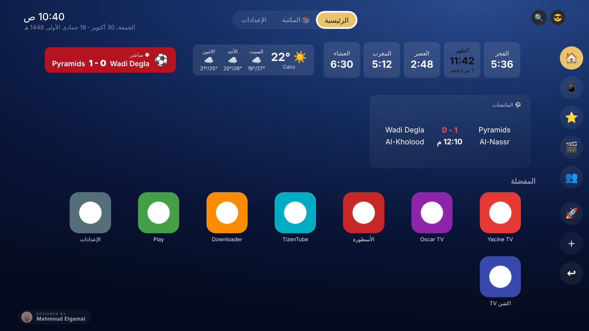

# Elgamal TV

لانشر عربي سريع لأجهزة Android TV (أندرويد 7 وأحدث) — من تصميم وتطوير **محمود الجمل**.

## أهم المميزات
- **خفيف وسريع** حتى على بوكس 2 جيجا رام: بيقف تماماً وانت جوه أي تطبيق، وبيقفل التطبيقات اللي خرجت منها.
- **مواقيت الصلاة والأذان**، والطقس بالأيام الجاية، والتاريخ الهجري.
- **الماتشات** من كل الدوريات والمنتخبات، وتنبيه بكل جون لفرقك حتى وانت جوه تطبيق تاني.
- **20+ ويدجت** تختار منها: الدولار والدهب، جدول الدوري، راديو، أخبار، تسبيح، تذكيرات، ألبوم صور…
- **5 ثيمات**: ثيمي، أبل TV، جوجل TV، فاير TV، نتفليكس.
- **ريموت من الموبايل**: تاتش، كتابة، أوامر صوتية بالعربي («افتح يوتيوب»، «اقفل بعد ساعة»)، صور، وقفل التليفزيون.
- **مكتبة عربية مجانية**: قرآن، إذاعات، كرتون، أفلام قديمة، مسرحيات.
- **متابعة المسلسلات**، بروفايلات للعيلة، قفل التطبيقات برقم سري، ونسخة احتياطية على تيليجرام.

## التحميل

| | الرابط |
|---|---|
| 📺 **اللانشر (للتي في بوكس)** | https://github.com/Mahmoud-Elgamal2026/TVLauncher/releases/download/stable/TVLauncher.apk |
| 📱 **ريموت الموبايل (Phone Remote)** | https://github.com/Mahmoud-Elgamal2026/TVLauncher/releases/download/phone/PhoneRemote.apk |

اللينكين دول ثابتين وبيجيبوا آخر نسخة دايماً.

## التثبيت على البوكس
1. نزّل تطبيق **Downloader** على البوكس.
2. اكتب لينك اللانشر فوق ودوس تثبيت.
3. افتح اللانشر واختاره كشاشة رئيسية.

اللانشر بيحدّث نفسه لوحده.
